# HeatLens

**A closer look at Mumbai's heat: forecasts, ward vulnerability and health impact.**

**Smart India Hackathon 2026 · Problem SIH26083 · "Extreme Heatwave Early Warning and Human Thermal Stress Index"** (Ministry of Earth Sciences / NCMRWF)

**Live demo:** _add after deploying (see DEMO.md → Deploy)_ · **API docs:** `/docs` on the API URL

Heat warnings usually look only at temperature. In humid Mumbai, **34 °C at 70 % humidity feels like ~47 °C**. HeatLens forecasts how hot it will *feel* (heat index and WBGT) 1–5 days ahead, corrects the weather models' errors with ML, turns the result into alerts, flags abnormally hot days, maps the most vulnerable of Mumbai's 24 BMC wards, estimates the extra-deaths risk from published Indian research, and writes advisories in **English, मराठी and हिंदी**.

    

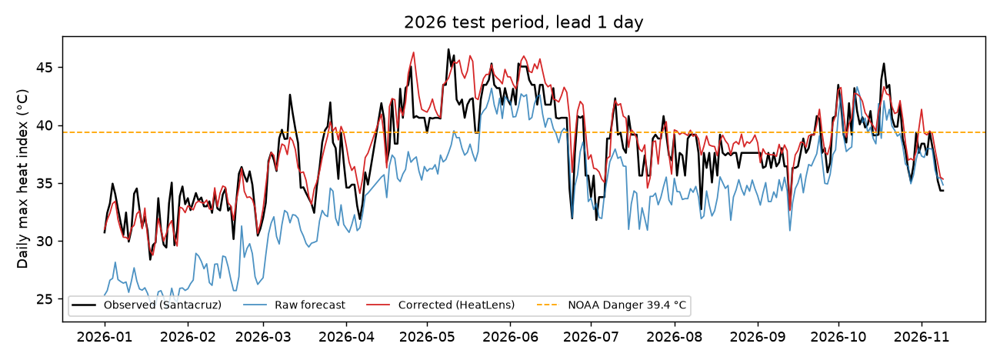

## Screenshots

| Model performance (2026 hold-out test) | Past heatwaves: real case study (Oct 2026) |
|---|---|
| 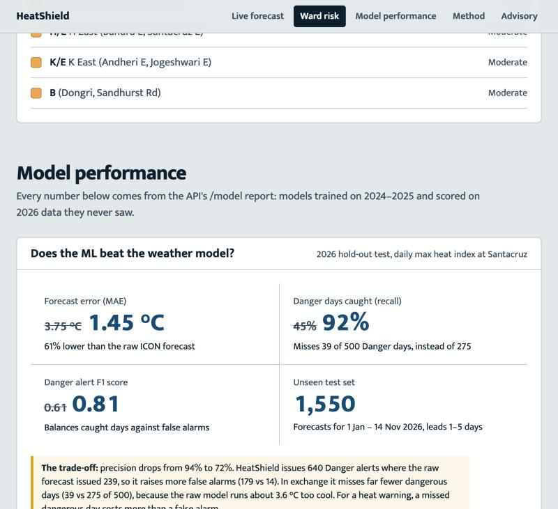 | 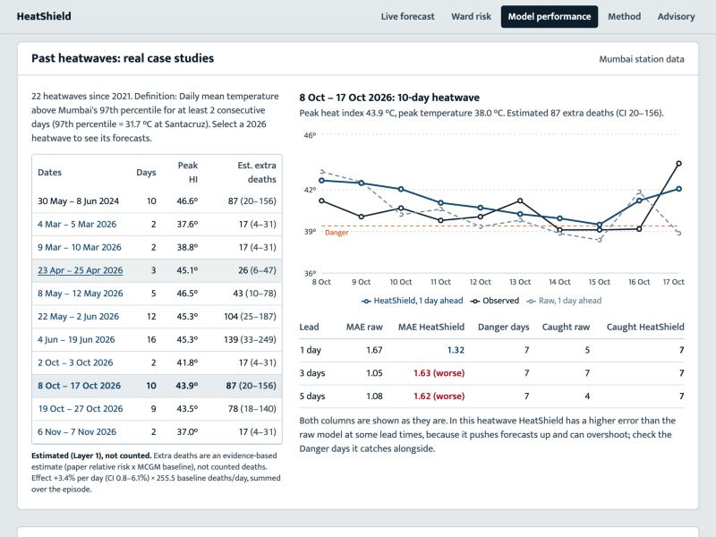 |
| **Feels-like gauge (live forecast)** | **Ward risk map with 5-day replay** |
| 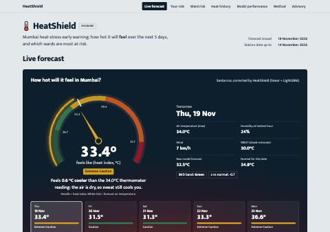 | 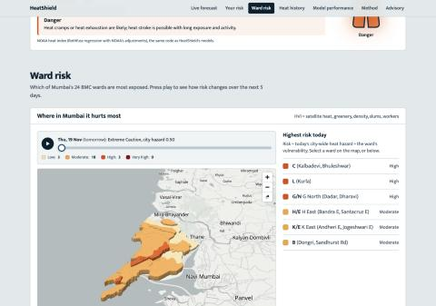 |
| **6-year heat calendar (2,117 real days)** | **"Am I at risk?" + what-if calculator** |
| 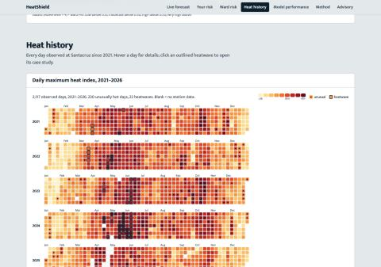 | 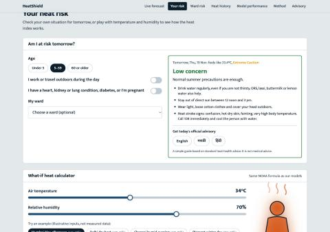 |

## Features

**Forecasting and ML**
- 1–5-day forecast of the daily max **heat index** and **WBGT** for Mumbai (Santacruz), live from 4 global models (ECMWF, GFS, ICON, JMA).
- **ML forecast corrector** trained on 2 years of archived forecasts vs real station observations: 3 baselines → linear regression → LightGBM → stacked final model, chosen by rolling validation.
- **Alert classification**: NOAA heat-index bands (green/yellow/orange/red) plus IMD's experimental bands, scored with precision/recall/F1 and confusion matrices.
- **Anomaly detection**: "abnormally hot for this date" from a 1991–2020 climate normal (z-score) and IsolationForest.
- **Explainability**: SHAP feature importance for the corrector; standardised linear coefficients.

**Geospatial**
- **Ward vulnerability map** of all 24 BMC wards: Landsat 8/9 land-surface temperature + NDVI (55 summer scenes via Microsoft Planetary Computer) and Census 2011 indicators → Heat Vulnerability Index (equal vs PCA weights) → **k-means clusters** (elbow + silhouette) → cross-checked against the city's Climate Action Plan.
- **Ward risk today** = city hazard (tomorrow's alert) × ward vulnerability.

**Health**
- **Layer 1:** extra deaths per heatwave day from a peer-reviewed Indian study, with a 95 % confidence interval and citation.
- **Layer 2:** state-level count model (Poisson → Negative Binomial) on NCRB heat deaths as a sanity check.

**Product**
- **LLM advisories** in English, मराठी and हिंदी (Groq → Gemini → template fallback) with a validator that blocks invented numbers.
- **FastAPI** backend (6 endpoints, Pydantic schemas, caching, CORS) and a **React dashboard** (forecast strip, ward map, model-performance page, advisory panel), mobile-friendly.
- **Telegram alert bot** (dry-run tested), **pytest** suite, one-command `RESULTS.md` generation, deploy configs for Render + Vercel.

## Results (all numbers from [RESULTS.md](RESULTS.md), generated by code)

**Forecast corrector**: observed daily max heat index at Santacruz. Trained Jan 2024–Dec 2025, tested on **all of 2026** (never seen during training or model selection).

| Method (test 2026, all leads) | MAE °C | RMSE °C |
|---|---|---|
| A · Raw forecast (DWD ICON) | 3.75 | 4.45 |
| B · Persistence | 2.22 | 2.92 |
| C · Climatology | 2.25 | 2.73 |
| LightGBM | 2.04 | 2.52 |
| Linear regression | 1.45 | 1.82 |
| **Linear + LightGBM (final)** | **1.45** | **1.86** |

- **MAE 3.75 → 1.45 °C (−61 %)**, better than the raw forecast at every lead time from 1 to 5 days (1-day: 3.71 → 1.28 °C).
- **Danger days (heat index ≥ 39.4 °C):** recall 0.45 → 0.92, F1 0.61 → 0.81. Precision drops 0.94 → 0.72: more false alarms, far fewer missed dangerous days.
- **Honest finding:** LightGBM alone was *worse* than linear regression. The raw forecast's cool bias drifts over time (+2.8 °C in training, larger in 2026), and tree models cannot extrapolate beyond the targets they saw. The final stack was chosen by rolling validation inside 2025, not on the test set.

**Anomalies (2026):** 27 days ≥ 2σ above the 1991–2020 normal for their date; IsolationForest flags 10, 9 of them shared (Cohen's κ 0.46).

**Ward vulnerability:** 24 wards; HVI from Landsat summer LST + NDVI (55 scenes, 2023–25) + Census 2011 density, slum share and worker share. Equal vs PCA weights give ρ = 0.994. K-means k = 4 (silhouette 0.305). Most vulnerable: C, L, G/N, H/E, K/E. Our HVI vs MCAP's ward heat data: Spearman ρ = 0.926.

**Layer 1, extra deaths (evidence-based estimate, not a clinical prediction):** the Env. Int. 2024 study includes Mumbai: +3.4 % deaths (95 % CI 0.8–6.1) when daily mean temperature exceeds Mumbai's 97th percentile for ≥ 2 days. With MCGM's 93,255 deaths in 2023 (255.5/day), that is **≈ 8.7 extra deaths per heatwave day (CI 2.0–15.6)**.

**Layer 2, state model:** NCRB heat-death counts (213 state-years, 2017–22) vs ERA5 danger days at state capitals. Poisson is heavily overdispersed (37.5), so Negative Binomial: **+5.8 % reported heat deaths per 10 extra danger days (CI 1.1–10.8 %)**, a sanity check that agrees in direction with Layer 1.

## Figures (generated by the pipeline)

| Ward layers (LST, NDVI, HVI, clusters) | SHAP: what drives the correction |
|---|---|
| 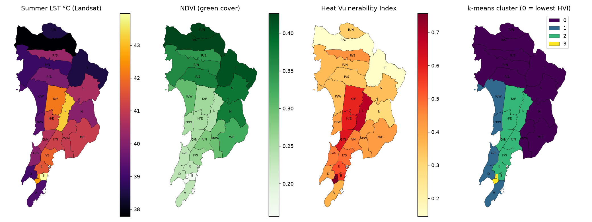 | 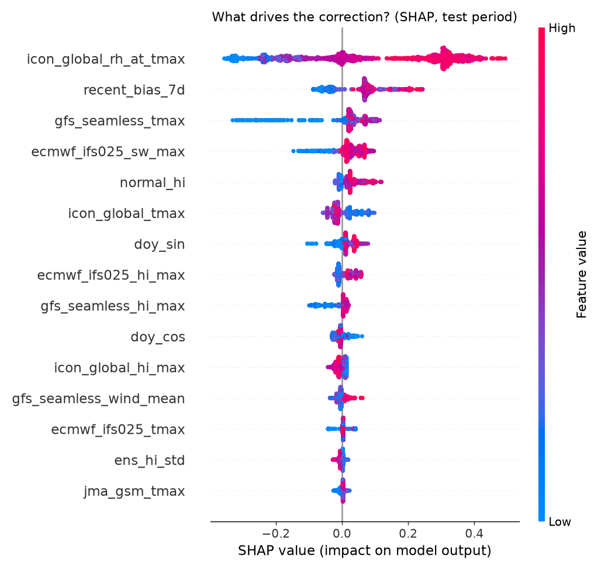 |
| **Confusion matrix: raw forecast** | **Confusion matrix: HeatLens** |
| 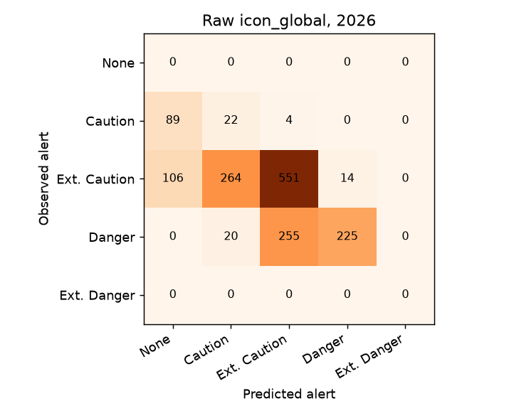 | 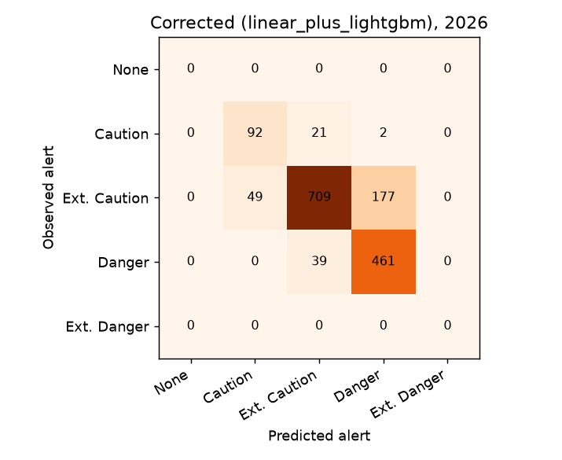 |
| **2026 anomalies (z-score + IsolationForest)** | **Choosing k for k-means** |
| 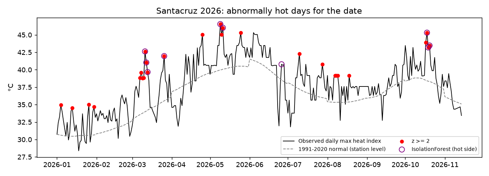 | 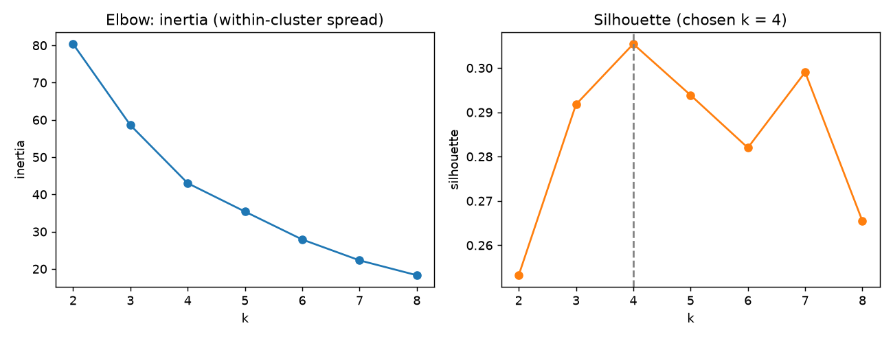 |

## How it works

```
GHCNh station obs ─┐
ERA5 1991→now ─────┼─► daily heat index / WBGT ─► climatology + anomalies (z-score, IsolationForest)
4 models' archived ┘                │
forecasts (Previous Runs)           ▼
live forecast ──────────► ML corrector (linear + LightGBM) ─► NOAA / IMD alerts
                                    │
Landsat LST+NDVI + Census ─► ward HVI + k-means ─► ward risk = hazard × vulnerability
Env. Int. 2024 relative risks ─► extra deaths/day ± 95 % CI
                                    ▼
          FastAPI (/forecast /wards /risk /advisory) ─► React dashboard · LLM advisories (EN/MR/HI)
```

| Capability | Where |
|---|---|
| Forecasting / time series | 1–5-day heat index (`models/corrector.py`) |
| Regression | forecast correction; Poisson state model (`models/state_health.py`) |
| Classification | NOAA + IMD alert levels, precision/recall/F1 (`models/alerts.py`) |
| Anomaly detection | z-score + IsolationForest (`models/anomaly.py`) |
| Clustering | k-means of wards, elbow + silhouette (`models/vulnerability.py`) |
| Explainability | SHAP (`docs/figures/shap_summary.png`) |
| Geospatial / satellite | Landsat 8/9 LST + NDVI via Planetary Computer (`ingest/satellite.py`) |
| GenAI | Groq → Gemini → template advisories with a number validator (`llm/advisory.py`) |

## Tech stack

**Data/ML:** Python 3.13, pandas, NumPy, scikit-learn, LightGBM, SHAP, statsmodels · **Geo:** geopandas, rasterio, odc-stac, pystac-client (Planetary Computer) · **API:** FastAPI, Pydantic, Uvicorn · **Frontend:** React 19, Vite, Tailwind CSS 4, react-leaflet, Recharts · **LLM:** Groq, Gemini · **Testing:** pytest · **Deploy:** Render (API), Vercel (web).

## API

| Endpoint | Returns |
|---|---|
| `GET /health` | service status, loaded models |
| `GET /forecast?days=5` | per day: raw vs corrected heat index, WBGT, NOAA + IMD alert, anomaly flags |
| `GET /wards` | GeoJSON of 24 wards with HVI, cluster, today's risk |
| `GET /risk` | Layer 1 extra-deaths estimate with 95 % CI and citation |
| `GET /model` | test-set metrics, 2026 backtest, confusion matrices, SHAP, anomalies, clustering, health models |
| `POST /advisory` | advisory text in `en` / `mr` / `hi` and which provider wrote it |

## Data sources

- **Observations:** NOAA GHCNh via Meteostat 2.2.3, Santacruz 43003 (main) and Colaba 43057 (secondary). Real measurements only; Meteostat's model gap-filling is excluded.
- **Reanalysis:** ECMWF ERA5 via the Open-Meteo Historical API (`models=era5`), 1991→now.
- **Forecasts:** Open-Meteo Previous Runs API (ECMWF IFS 0.25°, NOAA GFS, DWD ICON, JMA GSM) and Forecast API.
- **Satellite:** Landsat 8/9 Collection 2 Level-2 (Microsoft Planetary Computer).
- **Wards and demographics:** DataMeet BMC ward boundaries; Census 2011; BMC/WRI MCAP Vulnerability Assessment (2022).
- **Health:** Environment International 184 (2024) 108461; state heat-death data (see `docs/LAYER1_2_HEALTH.md`).
- **Alert bands:** NOAA/NWS heat index; IMD experimental heat index (PIB, 20 Jul 2023).

## Limitations (please read)

- **Two stations for a city of 12 million.** Santacruz is the main truth; Colaba reports only at daytime synoptic hours.
- **Coarse models.** ERA5 and global forecast models are ~10–25 km. Ward-level differences come from satellite LST, not from the forecast. ERA5 is 1.5–3.5 °C cooler than the station (heat index), so climate normals are shifted by a monthly offset.
- **WBGT** uses the Australian BoM approximation from temperature and humidity only (no sun or wind term), so it overestimates in cloud, wind and at night.
- **Live data lag.** GHCNh observations arrive about 3 days late, so the live "recent observation" features use the latest available day.
- **The corrector's precision is lower** than the raw forecast's for Danger alerts; the tuning favours catching dangerous days.
- **Anomaly rate.** The z-score uses ERA5's day-to-day spread, which is smaller than the station's, so more days are flagged than a textbook 2σ rate would suggest.
- **Ward HVI:** Census 2011 is old, `worker_share` is a weak exposure proxy, and density is gross (forest/mangrove wards look less dense). Our HVI agrees with MCAP's heat data (ρ 0.93) but **not** with MCAP's housing-vulnerability order (ρ −0.34, not significant), because ours is driven by island-city density and surface heat.
- **Layer 1** applies multi-city relative risks to Mumbai: an evidence-based estimate, **not a clinical prediction**.
- **Layer 2:** official Indian heat-death counts are known undercounts and the dataset is small (pseudo-R² 0.011), so it is a sanity check only. data.gov.in downloads need a captcha/API key, so the same NCRB tables were taken from official Parliament answers (PIB); one capital per state is a crude exposure.
- **Not built (stretch):** UTCI. The Telegram alert bot exists but needs your bot token.

## Run it

See **[DEMO.md](DEMO.md)** for exact commands, the deploy steps, a 2-minute talk script and likely questions. In short:

```bash
python -m venv .venv && source .venv/bin/activate && pip install -r requirements.txt && pip install -e .
```

```bash
uvicorn api.main:app --reload --port 8000
```

```bash
cd web && npm install && npm run dev
```

## Repo map

`src/heatlens/` (ingest · features · models · llm · bot · service) · `api/` FastAPI · `web/` React · `notebooks/` EDA · `tests/` pytest · `artifacts/` trained models + results · `docs/` spec, API contract, per-layer notes, figures.
